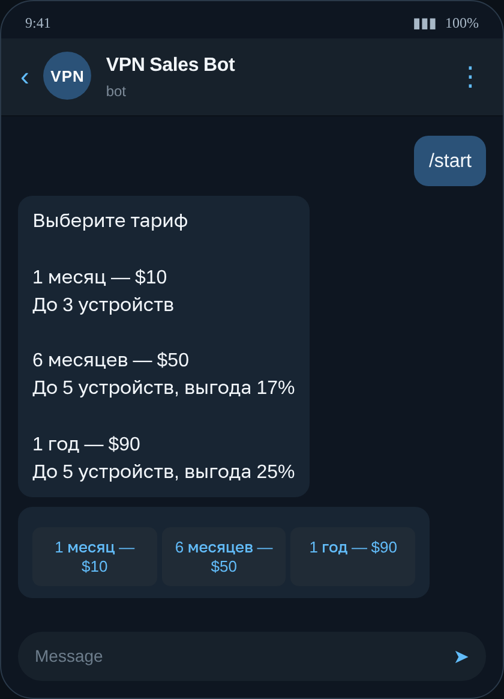

# VPN Sales Bot

**Демо Telegram-бота для продажи VPN-подписок.**

[](#запуск)
[](#как-это-работает)
[](#как-это-работает)
[](LICENSE)

**[Открыть case study →](https://jefo.github.io/vpn-sales-bot/)**



---

## Что это

Маленький бот, который показывает три тарифа VPN, имитирует оплату и отдаёт тестовый `.ovpn`-конфиг. Сделал как заготовку для сценария «оплатил → получил конфиг», без биллинга и реального сервера.

Подходит как пример структуры: тарифы → заказ → оплата → выдача файла.

---

## Что умеет

- Показывает тарифы: 1 месяц, 6 месяцев, 1 год.
- Показывает состав выбранного тарифа и сумму.
- Имитирует оплату.
- Отдаёт демонстрационный OpenVPN-конфиг.
- Возвращает к списку тарифов.

---

## Сценарий

```mermaid
flowchart LR
    A[/start] --> B[Тарифы]
    B --> C[Выбранный тариф]
    C --> D[Оплата]
    D --> E[Конфиг .ovpn]
    C --> B
```

---

## Запуск

Нужен [Bun](https://bun.com) и токен от [@BotFather](https://t.me/BotFather).

```bash
bun install
cp .env.example .env
```

В `.env`:

```env
BOT_TOKEN=123456:AA...
```

```bash
bun run start
```

---

## Структура

```text
src/
├── domain/
│   └── plans.ts      # тарифы и демо-конфиг
└── index.ts          # polling, меню, оплата, выдача
```

Всё помещается в двух файлах. Если проект вырастет, следующим шагом будет вынести состояние и заказы в отдельный слой.

---

## Как это работает

- Long polling через `getUpdates`.
- Тарифы — константы в `plans.ts`.
- `callback_data` содержит ID тарифа (`plan:2`), выбранный тариф запоминается по `chatId`.
- «Оплата» — просто переход к выдаче конфига; никаких платёжных API.
- Конфиг отправляется текстом в `<pre>`, чтобы его можно было скопировать.

---

## Ограничения

- Нет реальной оплаты и проверки платежа.
- Нет генерации уникальных ключей и привязки к пользователю.
- Нет базы данных и истории заказов.
- Конфиг — заглушка, а не рабочий сервер.
- Нет ограничения по устройствам, трафику и сроку.

---

## Что бы добавил дальше

- Интеграцию с платёжным провайдером и вебхуком.
- Генерацию WireGuard/OpenVPN-конфига на сервере.
- Учёт подписок, продлений и лимитов.
- Отзыв доступа по истечении срока.
- Админку для тарифов и промокодов.

---

## Лицензия

MIT.
